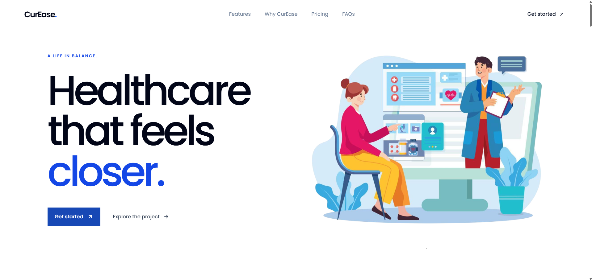
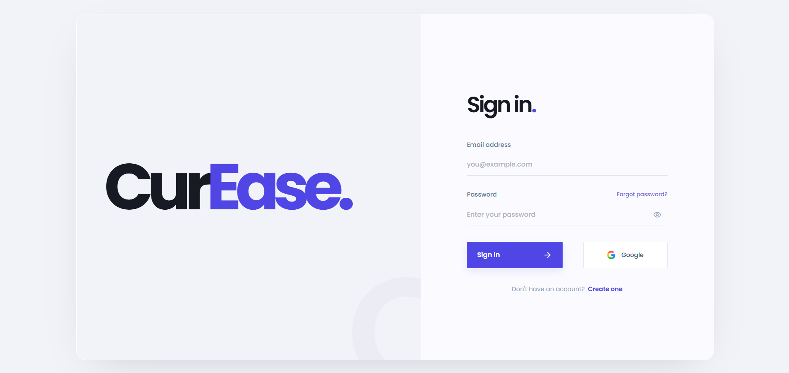
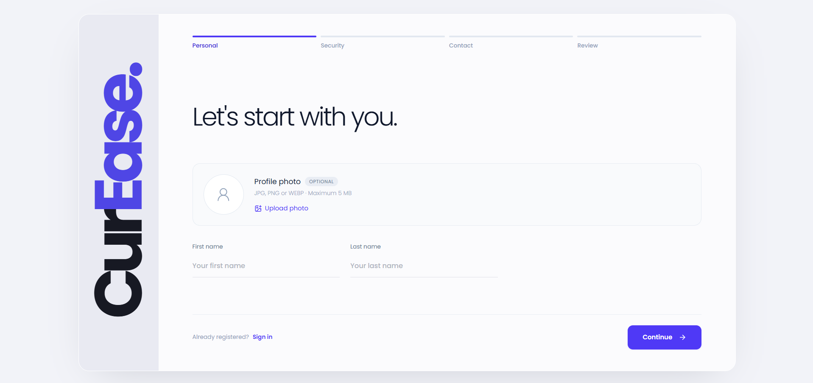
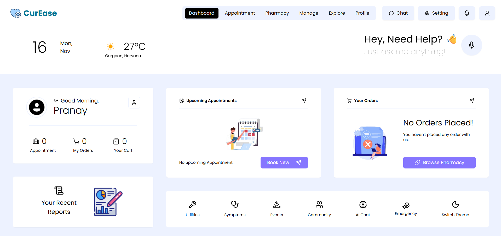
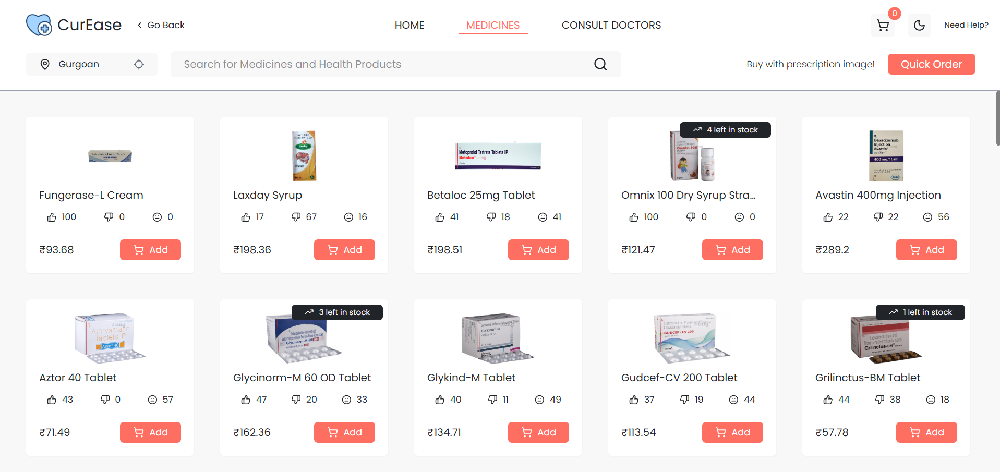
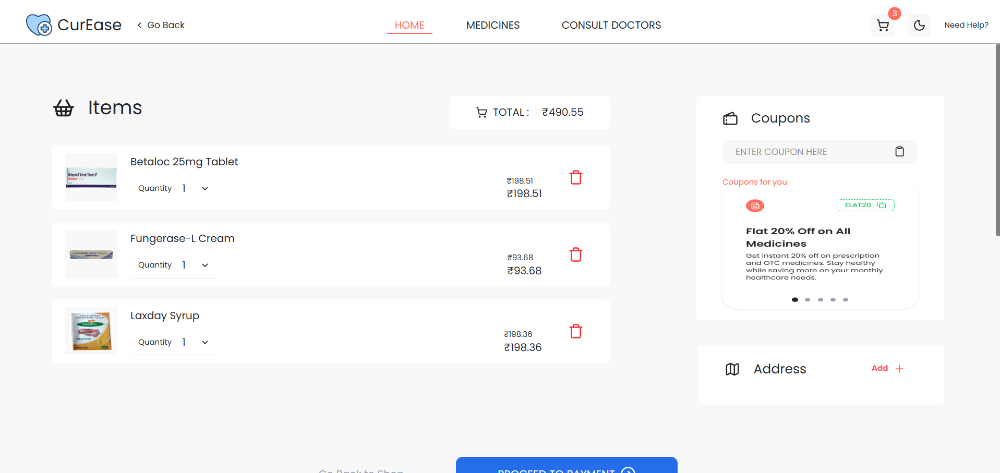
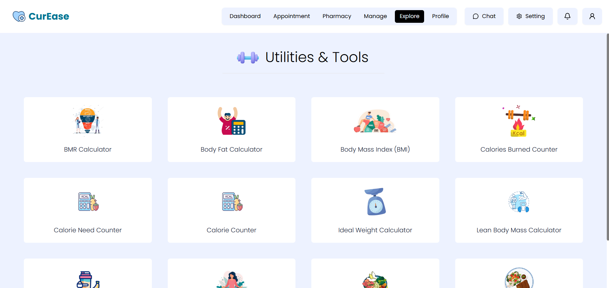
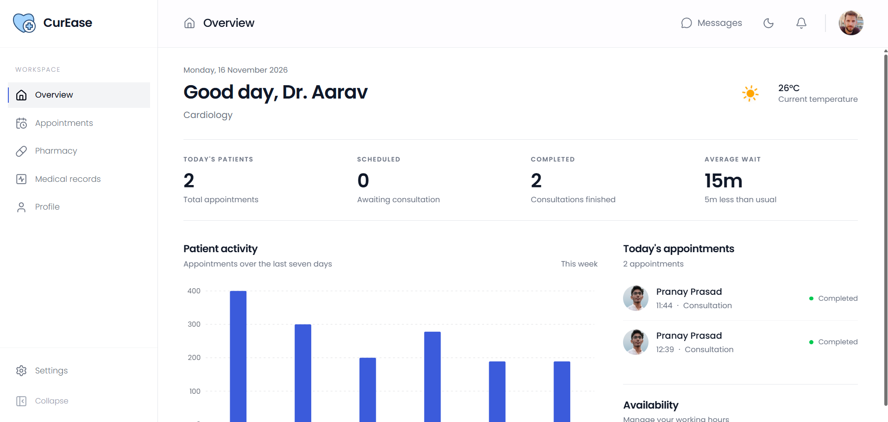

<div>
<h1>Curease</h1>
</div>
<!-- <h3>Smart Healthcare, Simplified</h3> -->


<!-- --- -->
<details open>
  <summary><strong>Table of Contents</strong></summary>
  <ol> 
    <li><a href="#getting-started">About</a></li>
    <li><a href="#core-features">Core Features</a></li>
    <li><a href="#tech-stack">Tech Stack</a></li>
    <li><a href="#getting-started">Getting Started</a></li>
    <li><a href="#future-enhancements">Future Enhancements</a></li>
    <li><a href="#contact">Contact</a></li>
    <li><a href="#screenshots">Screenshots</a></li>
  </ol>
</details>

## About
CurEase is a healthcare-focused platform designed to simplify patient management and make healthcare services more accessible through technology. It brings together patient information, healthcare workflows, intelligent analysis, and digital tools in a unified application.

The platform aims to provide a smoother experience for both patients and healthcare professionals through an intuitive interface and integrated backend services.


## Core Features

### 🩺 Symptom-Based Disease Detection
- Input symptoms and get AI-predicted probable conditions  
- Early awareness support (not a medical diagnosis)

### 🍎 Nutrition Analysis from Food Images
- Upload food images
- Get calories, nutrients, and dietary insights instantly

### 📁 Medical Report Management
- Secure upload and storage of lab reports & prescriptions
- Easy access anytime

### 👨‍⚕️ Doctor–Patient Interaction
- Appointment scheduling
- Secure chat system

### 📊 Personalized Health Dashboard
- Health summaries & reminders
- Smart recommendations

### 🔠 Image-to-Text Processing
- Upload your prescription
- Order them each seperately


## Tech Stack

| Layer | Technologies |
|------|-------------|
| 🖥️ Frontend | React.js, Tailwind CSS, Framer Motion|
| 🧑‍💻 Backend | Node.js, Express.js, Flask |
| 💿 Database | MongoDB, Firebase |
| 🤖 Machine Learning | Python, Scikit-learn, TensorFlow |
| 📞 APIs | REST APIs, Health & Nutrition APIs |
| 🔐 Authentication | OAuth / JWT |
| 🌐 Deployment | Vercel |


<!-- ## WorkFlow

1. User authentication via email or Google  
2. Dashboard overview of health data  
3. Symptom analysis using ML models  
4. Food image nutrition analysis  
5. Medical report storage & tracking  
6. Doctor appointment & chat system  
7. Smart reminders & notifications   -->

<!-- --- -->

## Getting Started

### 🚀 Prerequisites
Make sure you have the following installed:
- Node.js (LTS recommended)
- npm
- Python 3.11+
- MongoDB / MongoDB Atlas (Cloud Hosted Free)
- Git

### ©️ Clone the Repository
```bash
git clone https://github.com/prasad-pranay/curease.git
cd curease
```

### 🖥️ Frontend Setup
Refer to [Curease Frontend Setup](CurEase%20frontend/README.md)

### 🧑‍💻 Backend Setup
Refer to [Curease Backend Setup](curease%20backend/README.md)
<!-- ```bash
cd backend
npm install
cp .env.example .env
npm run dev
``` -->

<!-- ### Frontend Setup
```bash
cd frontend
npm install
npm start
``` 

Open: http://localhost:3000
-->

<!-- --- -->

<!-- ## 📡 API Overview

| Endpoint | Method | Description |
|--------|--------|-------------|
| /auth/signup | POST | Create account |
| /auth/login | POST | Login user |
| /symptoms/analyze | POST | Predict disease |
| /food/analyze | POST | Analyze food image |
| /reports/upload | POST | Upload report |
| /reports/:id | GET | Get report |
| /appointments | GET / POST | Manage appointments | -->

<!-- --- -->

<!-- ## 🗺️ Roadmap

- Symptom-based disease detection  
- Nutrition analysis from images  
- Medical report tracking  
- Doctor–patient chat  
- Push notifications  
- Wearable device integration   -->

<!-- --- -->

## Future Enhancements

- 📽️ Video consultations
- 🧑‍⚕️ Health trend analytics
- 🗣️ Multi-language support
- ❤️‍🩹 Insurance system integration
- ⛑️ Advanced AI predictions

<!-- --- -->

## Project Structure

```
CurEase/
├── frontend/     # frontend folder
├── backend/      # backend folder
├── sample/       # files for github readme
├── .gitignore    # files to ignore for github
└── README.md     # This current file
```

<!-- --- -->


<!-- ## 📬 Contact -->
## Contact

- 😺 GitHub: https://github.com/prasad-pranay  
- 📧 Email: prasadpranay2005@gmail.com
- 🫠 Portfolio: https://pranay-resume.vercel.app
- ⚽ Instagram: [pranayy.c3](https://www.instagram.com/pranayy.c3/)

## Screenshots
|Landing Page| Login Page|
|---|---|
|||

|Signin Page| Patient Page|
|---|---|
|||

|Pharmacy Page| Checkout Page|
|---|---|
|||

|Utilities Page| Doctor Page|
|---|---|
|||


